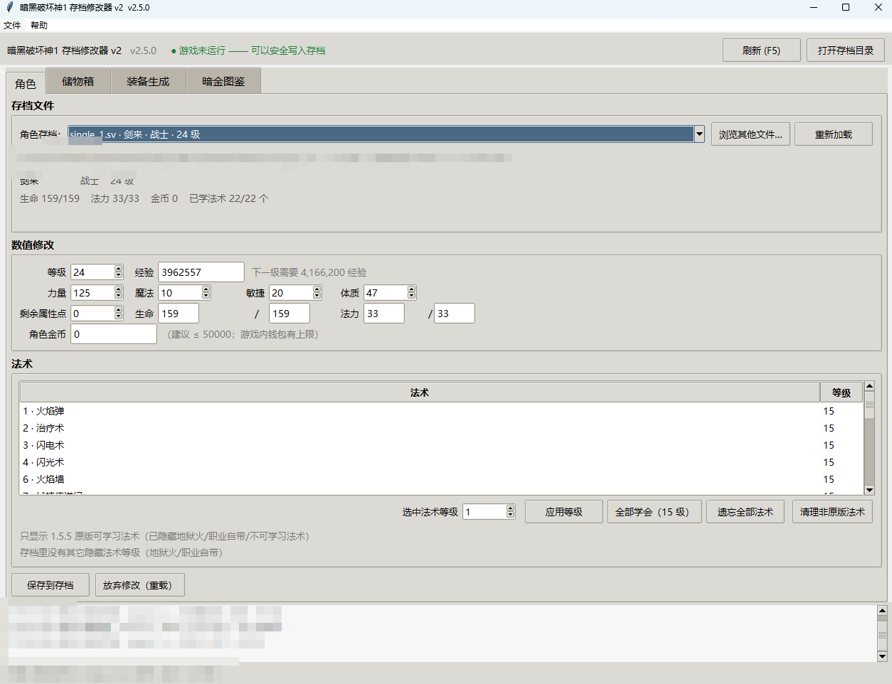
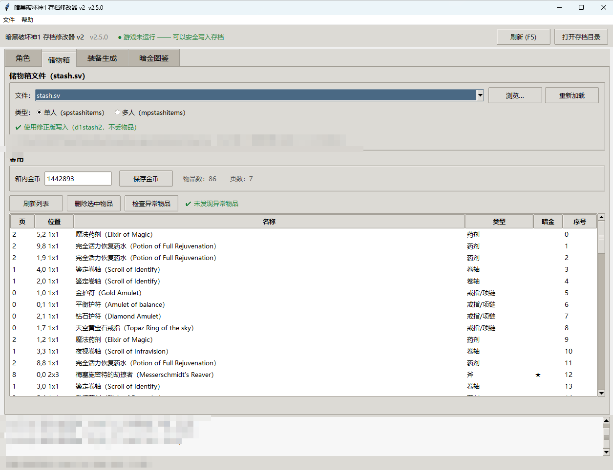
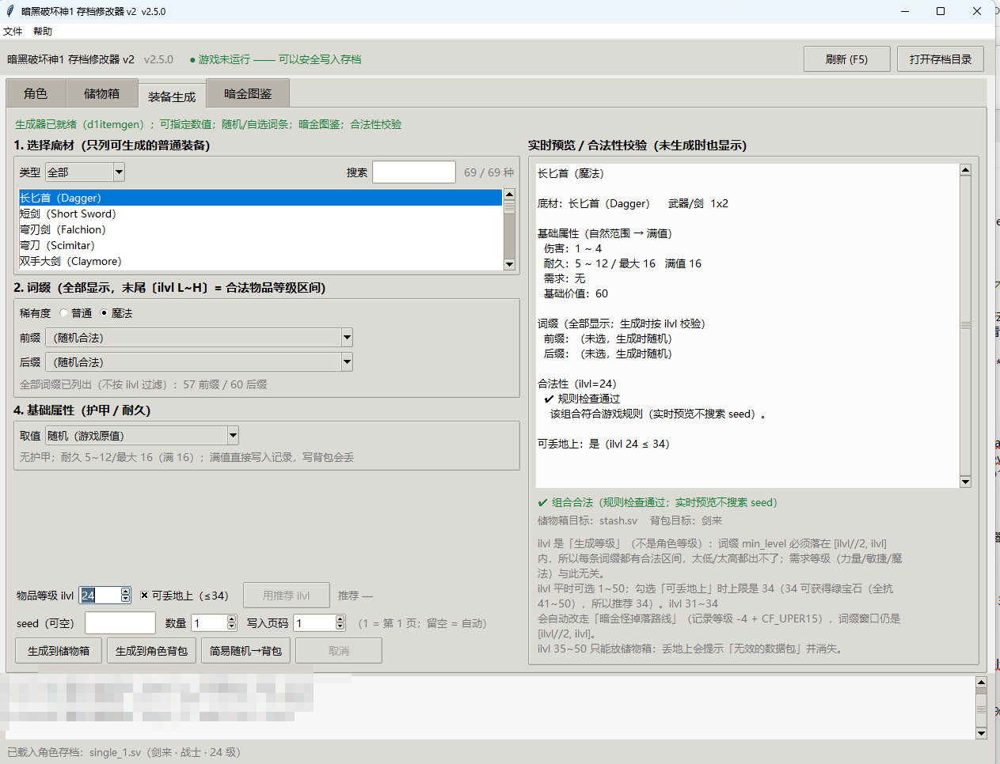
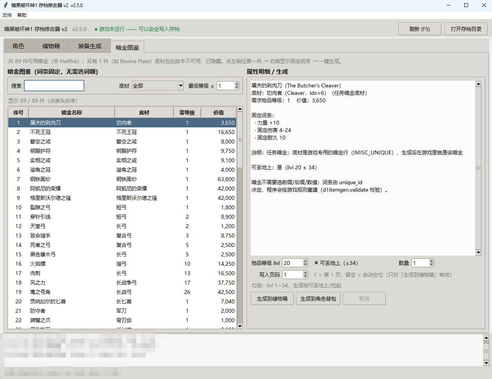

# 暗黑破坏神1 存档修改器 v2

## 游戏本体

[DevilutionX](https://github.com/diasurgical/DevilutionX)

DevilutionX 是《暗黑破坏神》和《地狱火》的移植版本，旨在让游戏运行更简单，
并提供引擎改进、错误修复以及一些其他可选的游戏功能。

## 中文翻译对照

[fonts.mpq](https://github.com/diasurgical/devilutionx-assets/releases/download/v2/fonts.mpq)

本修改器适用于 DevilutionX 原版《暗黑破坏神 1.5.5》。《地狱火》未做专项适配。

## 功能

1. 角色修改，建议只修改等级和对应的剩余属性点以保留游戏体验。

   

2. 储物箱金币修改，附带列表，可删除物品。

   

3. 装备合法生成，自由选择底材、前缀、后缀、基础属性（生成需符合游戏规定）。

   

4. 暗金装备图鉴+生成。

   

## 使用

- 下载 exe：[Releases](https://github.com/chiaki3924/diablo-modifier/releases)，单文件，不需要安装 Python。
- 修改前完全退出游戏，并先备份 `%APPDATA%\diasurgical\devilution`。
- 源码运行、打包和测试见 [docs/DEVELOPING.md](docs/DEVELOPING.md)。

## 许可

代码 MIT；`data/game-tables/` 下的 DevilutionX 数据表为 GPL-3.0。
详见 [NOTICE.md](NOTICE.md)。
